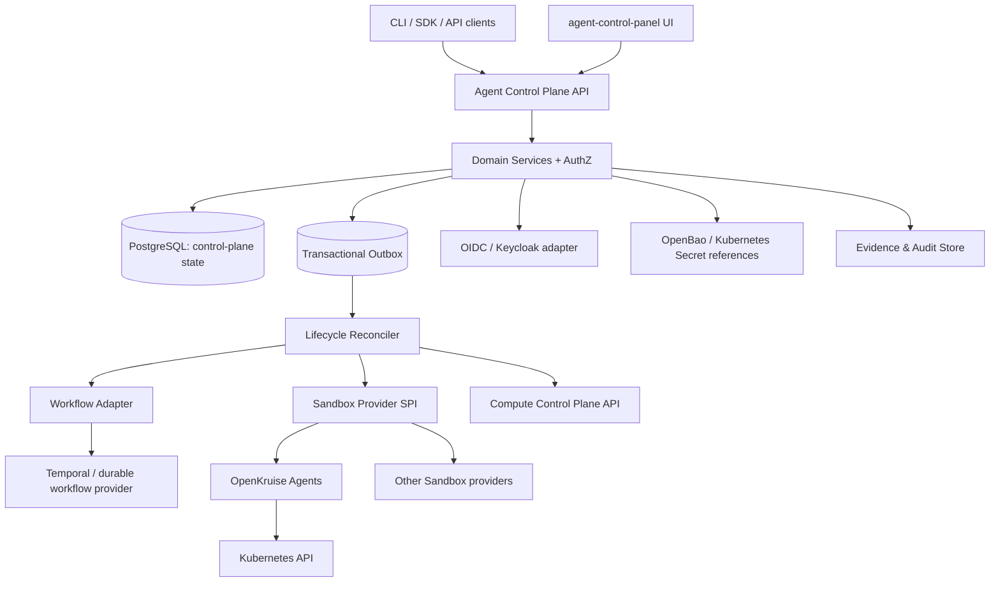

# Architecture Baseline — Agent Control Plane Rewrite

Status: **proposal baseline for implementation**  
Date: 2026-11-02  
Target: `avaargsh/agent-control-panel`

## 1. Product shape

The product is a thin Agent Infrastructure Control Plane. It exposes a stable API and reconciles declared Agent intent into external execution systems. It is Kubernetes-first but does not require all Agent execution providers to be Kubernetes-native.

The central contract is:

- **Control Plane authority:** Agent/Session identity, release intent, RunIntent desired state, policy bindings, lifecycle coordination and references to evidence. Canonical Run/Task/Attempt identity and state belong to Agent Runtime.
- **Runtime authority:** actual execution plan semantics, workflow history, task/step scheduling, retry policy, wait/approval continuation and checkpoint details.
- **Provider authority:** external resource state and side effects; the Control Plane tracks references and reconciles observed state.

## 2. Component model

Initial deployable modules should be kept coarse: API/domain service, reconciler, adapter interfaces and UI. Split deployables only when scaling or security isolation evidence requires it.

## 3. Domain model and identity

### Core objects

- `Agent`: stable logical identity, owner/tenant scope and desired configuration reference.
- `AgentBundle`: immutable content-addressed package; declares runtime, tools, context inputs, policies and resource requirements by reference.
- `AgentRelease`: immutable bundle digest plus release intent; status records rollout/reconciliation progress.
- `Session`: stable logical work/conversation identity that survives multiple Runs and runtime restarts.
- `RunIntent`: the ACP-owned, durable request for execution, distinct from an accepted Run and from its execution outcome.
- `Run`: a Runtime-owned durable execution instance linked to a Session/RunIntent; any status shown by ACP is a verified projection, not ACP-authoritative state.
- `FederationBinding`: maps a local provider identity to a remote control plane/provider and its trust constraints.
- `CredentialBinding`: secret/provider reference with scope, target and revocation semantics; secret bytes are never persisted in domain objects.
- `ContextProjectionPolicy`: declares allowed context sources, projection limits and provenance rules.
- `Evidence`: immutable reference to source event, artifact digest, provider operation and verification outcome.

### Identity separation

- `AgentIdentity`: durable logical identity, independent from AgentRelease and runtime instance.
- `SessionIdentity`: stable identity across Runs; owned by the Control Plane.
- `RunIdentity`: canonical Runtime-issued execution identity, stable for an accepted logical Run across retry and recovery; ACP may store only a verified reference.
- `WorkloadIdentity`: short-lived identity issued/bound to a specific runtime or Sandbox; revocable and scoped.
- `ProviderResourceIdentity`: provider-native identity recorded as a mapping, not promoted to canonical Agent identity.

A Sandbox UID, Pod name, workflow ID or credential identifier must not become the canonical Session identity.

## 4. State ownership and reconciliation

The ACP write path validates and persists ACP-owned desired state/RunIntent and its Outbox event atomically. Reconciliation is asynchronous and idempotent. External effect identities and their journals remain owned by the corresponding Runtime, Guard, Compute or provider boundary; ACP does not mint protected-action or provider-operation IDs.

The reconciler must distinguish:

- desired state from observed state;
- ACP's observed projection of Run state from the Runtime-authoritative execution state;
- provider acknowledgement from verified outcome;
- retryable errors from ambiguous/unknown side-effect outcomes.

On process restart, reconciliation resumes from durable records. An ambiguous provider operation is queried/reconciled before another side effect is attempted. Do not infer success solely from a timeout-free API response or from the target resource coincidentally matching desired state.

## 5. RunIntent and observed Run lifecycle (conceptual, not an API schema)

The following labels describe an illustrative Runtime-owned Run lifecycle, **not ACP-owned state transitions**. RunIntent acceptance alone does not create a Run or prove an effect. Only Runtime owns canonical Run state; ACP validates RunIntent transitions and projects verified Runtime receipts.

`Pending`: Runtime has recorded an execution not yet running (distinct from ACP's accepted RunIntent).  
`Running`: workflow/provider has accepted execution and Run is active.  
`Waiting`: execution is suspended on approval, input, timer or external event.  
`Succeeded`: terminal state backed by accepted completion evidence.  
`Failed`: terminal state with structured error and evidence references.  
`Cancelled`: cancellation intent reconciled with execution provider; terminal only after provider state is confirmed or cancellation outcome is explicitly represented as unknown.

State transitions are validated by their owning service, not by a shared ACP state machine. Runtime-owned terminal Run states remain immutable except for owner-authorized appended correction/verification evidence; ACP cannot mutate Runtime history.

## 6. External integrations

### Workflow

Temporal is the preferred durable execution engine integration. ACP stores canonical Agent/Session identity and RunIntent; only Runtime issues canonical Run and workflow IDs, which ACP may reference after authenticated durable reconciliation. Workflow history, activities, retries and continuation semantics remain owned by Temporal. An adapter maps RunIntent to Runtime execution requests and projects verified state/events without duplicating execution internals.

### Sandbox

Define a provider-neutral `SandboxProvider` interface for provision/claim, inspect, pause, resume, release, credential/context binding and operation reconciliation. OpenKruise Agents is a preferred Kubernetes implementation for warm pools, lifecycle, auto-pause/resume, SandboxUpdateOps and traffic controls. Provider-specific CRDs remain inside the adapter.

### Compute

Compute integration is via `compute-control-panel` API and provider SPI. Agent Control Plane expresses resource requirements and references; Compute Control Plane owns GPU inventory, allocation, queue/scheduler and infrastructure provisioning.

### Identity, secrets, policy

OIDC/Keycloak handles human authentication. Authorization is scoped and delegated; use a mature policy engine adapter. OpenBao/Kubernetes Secrets stores secret material. CredentialBindings only reference identities and paths, and must support revocation and auditable resolution.

## 7. Security boundaries

- AuthN for human/API caller is separate from AgentIdentity and WorkloadIdentity.
- Workload credentials are short-lived, audience-bound and least-privilege where provider support exists.
- Raw credentials must not appear in AgentBundle, AgentRelease, Session/Run payloads, logs, traces, Events or Evidence.
- Sandbox egress policy and MCP tool ACL are enforced by Sandbox Provider / gateway; Control Plane records intended policy bindings and audit links.
- Cross-tenant references are denied by default and validated on every read/write and provider binding.
- Audit records correlate actor, tenant, Agent, release digest, Session, Run, provider operation and evidence digest.

## 8. Persistence and APIs

PostgreSQL is the initial authoritative store for Control Plane domain state, idempotency keys, outbox and audit metadata. Evidence payloads may live in content-addressed object storage; database records retain digest and URI.

API shape should be resource-oriented and versioned (`/api/v1`). Public API schemas and provider SPI contracts need compatibility tests. Kubernetes CRDs can be an optional declarative interface later; they must map to the same domain authority and not create a second independent source of truth.

## 9. Non-goals

Do not implement a proprietary workflow engine, Agent framework, sandbox runtime, MCP gateway, IAM system, policy language, GPU scheduler or model serving stack. Do not couple the domain model to E2B or OpenKruise-specific API shapes.

## 10. Open decisions requiring design records

1. API implementation language/framework and domain module boundaries.
2. Event model: transactional outbox plus durable event stream choice.
3. Run idempotency and ambiguous provider outcome reconciliation schema.
4. Tenant model and authorization policy vocabulary.
5. Evidence canonicalization, signing and retention model.
6. Whether Kubernetes CRDs are a first-class API surface in v1 or an adapter.

These decisions must be recorded before implementation hardens the interfaces.
