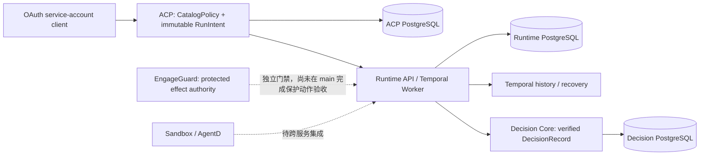

# 企业级 Agent 平台：求职作品演示与证据边界

> 作品定位：**Enterprise Agent Infrastructure / Agent Control Plane**。本页用于招聘面试、开源读者和评审者，演示的是**受控环境中的跨服务可靠执行证据**，不是生产交付声明。
>
> 基准：2026-11-21；`main` = [`4b2d6949ff2ea8996082e0e47650f2eeb1db6a6a`](https://github.com/avaargsh/agent-control-panel/commit/4b2d6949ff2ea8996082e0e47650f2eeb1db6a6a)（本次核查时）。仓库持续演进；展示任何新运行结果前须重新记录实际 HEAD、GitHub Actions run ID、源码依赖 SHA 与结论。

## 一句话说明

这个平台不是另一个 Agent 编排框架，而是为企业 Agent 提供可信身份与发布管理、持久化 Run 接受、跨进程恢复和可核验的执行证据。**ACP 只拥有 Tenant/Project、Agent/Release、Session、RunIntent 和治理引用**；Runtime 拥有 Run/Attempt/Turn 与 Temporal 历史；Decision 拥有 DecisionRecord；EngageGuard 拥有受保护操作的 Permit/Operation；Sandbox/Compute 分别拥有执行环境与资源生命周期。

## 代表性用户场景：只读 SRE 故障调查

业务目标：收到一个隔离测试环境的故障调查请求后，保证它以授权身份进入系统，在服务崩溃、ACK 丢失或重试后仍只对应**同一个** Runtime Run；后续 Decision 接受必须绑定原始输入和权威证据。如果授权或证据撤销，新的验证须拒绝，而不能凭模型输出绕过控制面。

这条演示**验证运行底座**，不声称已经自动完成真实生产告警的日志采集、根因定位、修复 PR、审批或工作区写入；这些是后续业务垂直链路。



## 当前可展示 / 不应展示为已交付

| 能力 | 当前证据级别 | 可安全表述 |
|---|---|---|
| OAuth 服务账号准入、CatalogPolicy 权威租户/角色校验、原始输入绑定 | main 历史集成 + 真实 Keycloak/PostgreSQL 测试 | **受控环境已验证** |
| mTLS Runtime 接受、丢失 ACK、SIGKILL/重启、Inspect 与同一 Run 的幂等恢复 | [已合并 ACP PR #68](https://github.com/avaargsh/agent-control-panel/pull/68)，精确 HEAD 历史 CI | **受控跨进程验收通过；不是生产 SLA** |
| Temporal Worker 恢复并由实际 Decision Core 接受同一 Run 的 Decision | [ACP PR #68 证据](https://github.com/avaargsh/agent-control-panel/pull/68)、[历史集成 CI](https://github.com/avaargsh/agent-control-panel/actions/runs/44261403683) | **源代码固定版本的非生产 E2E** |
| Guard 只读 Capability、原始 OAuth 客户端撤权、禁止 workspace.write 提权 | [PR #74](https://github.com/avaargsh/agent-control-panel/pull/74)、[#76](https://github.com/avaargsh/agent-control-panel/pull/76) 为 Open/Draft | **候选实现，尚不能宣称 main 已具备** |
| Guard/Runtime postflight 三权威拒绝 | [PR #77](https://github.com/avaargsh/agent-control-panel/pull/77) Open/Draft | **候选测试，不代表 Permit/执行动作** |
| MicroVM Sandbox、AgentD 长命令 Journal | [Issue #70](https://github.com/avaargsh/agent-control-panel/issues/70) | **待实现/联合验收** |
| Credential Broker 与默认拒绝 egress | [Issue #71](https://github.com/avaargsh/agent-control-panel/issues/71) | **待实现/联合验收** |
| 独立 Verifier、签名 Evidence/Trace、GitHub Issue→修复 PR→资源回收 | [Issue #72](https://github.com/avaargsh/agent-control-panel/issues/72) | **待实现/联合验收** |

**特别注意**：CI 绿色只证明该 run 的精确 commit、依赖版本、fixture 和断言。业务 Run 的持久化恢复 ≠ 受保护操作的 Exactly Once；不宣称 Guard Permit、真实工具副作用、生产 IAM/密钥、生产 K8s/MicroVM 资源回收或跨服务统一上线已获验收。

## M0 Issue Goal 输入与非派发受理：候选 PR，不属于 main 的演示结论

2026-11-21 核查时，Issue Goal 入门链已拆成三层独立、尚未合并的候选改动：

| PR | 新增的候选能力 | 本阶段不可宣称 |
|---|---|---|
| [#82](https://github.com/avaargsh/agent-control-panel/pull/82) | 严格校验 Issue Goal 输入、计算固定摘要、复用现有可信 RunIntent 准入 | 无自动 GitHub Issue→PR，非真实执行 |
| [#85](https://github.com/avaargsh/agent-control-panel/pull/85) | 核查公共 GitHub Issue 快照、固定基线 Commit 和来源约束 | 规则签名/授权的完整权威闭环未实现 |
| [#86](https://github.com/avaargsh/agent-control-panel/pull/86) | 内部 `POST /api/v1/goals:submit` handler；按认证上下文受理且 **不派发**；返回 `run_intent_id` | 无真实 TLS 监听器/服务接线、无运行时任务执行、无受保护写操作 |

依赖顺序为 **#82 → #85 → #86**。这些 PR 上的 Go/PG、OIDC 或模拟 HTTP 测试只证明各自的精确源码范围，不是把三层放到同一个真实 HTTP→OAuth→GitHub→PostgreSQL 部署中验证，也不代表 Workflow 已启动。

面试时如果展示候选 API，必须同时口述：`run_intent_id` 是 ACP 受理标识，不是 Runtime 的 `run_id`；**201/200 仅表示首次受理/幂等重放，并非任务完成**。HTTP 处理器没有启用到默认服务；不可对外展示为已上线可调用的产品入口。

下一步的最小实跑验收不是再加一套控制面，而是以可信 TLS Host 连接 OAuth/CatalogPolicy、GitHub 来源核验和现有 PostgreSQL RunIntent Authority，记录真实的首次受理、同键重放、变更输入冲突、授权撤销及 Outbox 观察。所有错误路径记录是否存在持久化写入；失败或不确定的步骤不得发出 Runtime Dispatch。完成此门禁前，后续 Sandbox、Guard、Verifier 和 GitHub PR 的交付链仍按 [#70–#72](https://github.com/avaargsh/agent-control-panel/issues/72) 标记为未交付。

## 5–10 分钟面试现场演示

以 GitHub Actions 的**非生产、可重新触发**测试作为最小可靠演示入口，避免对面试官环境或生产密钥的依赖。

**准备（约 1 分钟）**：展示仓库 [README](../../README.md) 的责任边界，以及本页证据级别。强调 ACP 不改写 Runtime 的 Run，不持有 Guard 的 Permit，也不把模型判断视为权限。

**步骤 A（约 2 分钟）— 授权准入**：打开 [Live OIDC workflow](../../.github/workflows/real-oidc-admission.yml)。它使用仅限本次测试的 Keycloak HTTPS issuer、OAuth service-account token、PostgreSQL CatalogPolicy 和 RunIntent 事务；验证授权、输入绑定和拒绝用例。重点查看日志里 `TestRealOIDCServiceAccountCatalogAdmission` 的 `RUN/PASS`，不能把 `Skip` 或零测试当作 PASS。

**步骤 B（约 3 分钟）— 同一个 Run 的恢复**：打开 [Golden Path workflow](../../.github/workflows/acp-temporal-golden-path.yml) 和 [PR #68](https://github.com/avaargsh/agent-control-panel/pull/68)。该 workflow 固定拉取 issuer fixture、Runtime 和 Decision 提交，使用三个隔离 PostgreSQL 数据库，编译实际服务和集成驱动，执行 OAuth → ACP RunIntent → Runtime/Temporal → Decision。重点解释：ACK 丢失时通过权威 Inspect/Journal 判定后续动作，SIGKILL 之后恢复到同一个 Run/Decision，而不是再生成一个 Run 或盲目执行。

**步骤 C（约 1 分钟）— 负例与产品边界**：展示“撤销证据后新的验证须拒绝”的历史集成断言；再指出 [#74–#77](https://github.com/avaargsh/agent-control-panel/pulls) 正在推进 Guard 的独立权威与动态撤权，**还没有受保护写入动作或生产级实时撤权的完整验收**。说明何时进入人工审批、为什么 UNKNOWN 必须被保留。

**结束（约 1 分钟）**：给出三种验收输出：确切身份绑定、同一 Run 的恢复证据、可解释的拒绝。展示下一阶段 Issue #70–#72，把“长任务可靠性”延伸为真实 AgentD、Broker、独立 Verifier 的生产候选闭环。

## 可复现命令（GitHub Actions）

安装并登录 [GitHub CLI](https://cli.github.com/) 后，在本仓库根目录运行。需要对该仓库具有 Actions 手动触发权限；仅使用仓库自己的测试 fixture，无生产账号或真实企业数据。

```bash
# 在可控的 main 提交上触发非生产验证；不要把旧 run 当作本次验证。
gh workflow run real-oidc-admission.yml --ref main
gh workflow run acp-temporal-golden-path.yml --ref main

# 找到新 run ID、head SHA、实际 status/conclusion。
gh run list --workflow real-oidc-admission.yml --limit 5
gh run list --workflow acp-temporal-golden-path.yml --limit 5
RUN_ID=123456789  # 替换为上一步输出的新 run ID
gh run view "$RUN_ID" --log
```

执行后在演示记录中填写以下字段，而不是预先宣称本次 PASS：

| 字段 | 填写规则 |
|---|---|
| 代码基线 | `git rev-parse HEAD` 或 Actions 的 `head_sha` |
| 环境 | workflow 文件、PostgreSQL 版本、Go 版本、Keycloak image digest |
| 外部依赖 | workflow 中 pin 的 Runtime / Decision / issuer SHA |
| 验收行为 | 实际被执行的 Test 名称、正负断言和故障点 |
| 结果 | Actions run URL、结论、测试日志片段 |
| 未覆盖 | Guard Permit/PEP、Sandbox、Broker、生产部署 |

### 本地复现范围（仅准入测试）

`scripts/test-real-oidc-admission.sh` 支持 `oidc`，但**不是不依赖环境的一键安装器**：调用前必须有本地 Docker daemon、OpenSSL、Python3、curl、Go 1.27.4、专用的临时 PostgreSQL 和 `PGTEST_DSN`，本地 `127.0.0.1:8443` 端口不可冲突。脚本会启动/清理临时 Keycloak，不应指向任何现有或生产 issuer。完整跨服务 golden-path 还需要 workflow 指定的多个已编译二进制、隔离数据库及不可变源码 pins；优先使用上面的 Actions 入口，不跳过这些条件。


### 复现后进行 CI 元数据一致性检查

从实际已完成的非生产 `workflow_dispatch` Run 导出 GitHub CLI 元数据，然后由本仓库的 fail-closed 检查器核验。它会拒绝错误 SHA、伪造仓库 URL、不属于 main 的 Run、缺少真实测试步骤、FAILED 或 SKIPPED 的步骤；**它不验证 JSON 文件的签名，不是独立的业务结果证明，也不授予受保护操作权限**。

```bash
# 从前面的 gh run list 中选择本次真实 Run；不要使用示例 ID。
RUN_ID=123456789  # 替换为真实 GitHub Actions run ID
EXPECTED_SHA="$(git rev-parse main)"  # 全长 SHA；必须与该 Run 的 headSha 完全一致
gh run view "$RUN_ID" --json databaseId,url,workflowName,headSha,headBranch,event,status,conclusion,attempt,jobs > /tmp/acp-run.json
python3 scripts/portfolio_ci_receipt.py --run-json /tmp/acp-run.json --expected-sha "$EXPECTED_SHA" --scenario golden
# 如果核查的是 Live OIDC workflow，请将 --scenario 改为 oidc。
```

本地回归：`python3 -m unittest discover -s tests -p 'test_portfolio_ci_receipt.py' -v`。请同时查看该 Run 的原始日志、外部源代码固定 SHA、正负例断言和需要独立复核的授权边界；不要把 `CI_METADATA_CHECK_ONLY` 写成 `production accepted`。

## 面试回答（约 90 秒）

> 我做的不是一个新的 LangGraph，而是企业 Agent 的控制与运行治理平台。ACP 负责 Agent 发布、Tenant/Project/Session、授权准入和 RunIntent，Temporal 所在的 Runtime 负责真正的 Run/Attempt/恢复，Decision 独立保存决策权威，受保护的写入必须经过 EngageGuard。设计重点是避免跨服务重复拥有状态，以及长任务超时后重复产生副作用。  
>
> 在已合并的非生产 Golden Path 中，我把真实 OAuth 准入、PostgreSQL 事务、mTLS Runtime 接受、Temporal Worker 和 Decision 连接起来，注入 ACK 丢失与 Worker SIGKILL，验证故障后还是同一个 Run 和决策记录，也验证源撤销后的拒绝。这是运行底座的跨服务工程证据。Guard 的实时撤权和沙箱执行还在分阶段 PR/Issue 验收，不会把候选能力包装成已经生产落地。

## 下一轮开发验收优先级

1. **P0：闭合 Guard 的只读及受保护范围拒绝**：先处理 #74–#77 的 stack/依赖、精确 SHA CI、实际跨服务负例和独立 review；不把“Release observation”冒充 Permit。
2. **P0：一条真实命令执行链**：同一 Run → SandboxLease → AgentD → Durable Command Journal → SIGKILL/未知状态安全恢复；对应 #70，要求生产外的真实可重复 fault injection。
3. **P0：凭证与网络安全**：绑定 Tenant/Run/Attempt 的短时 Broker、egress deny-by-default 与撤销；对应 #71。
4. **P0：独立结果发布**：Verifier 独立凭证/不可篡改输入，签名 Evidence + Trace，人工合并前门禁和资源回收；对应 #72。
5. **P1：真正的场景应用**：在上述底座可验收后接入 SRE read-only RCA 或 Data Agent 真实查询，分别验证内容质量、权限边界和最终可信答案。不能使用 mock 查询或静态输出代替业务验收。

最小可公开完成定义：一个陌生评审者能够在干净 runner 上复现指定测试、检查确切 SHA 和负例、指出什么已实现/什么未验收，并能沿着同一 Run 解释恢复与授权责任归属。
