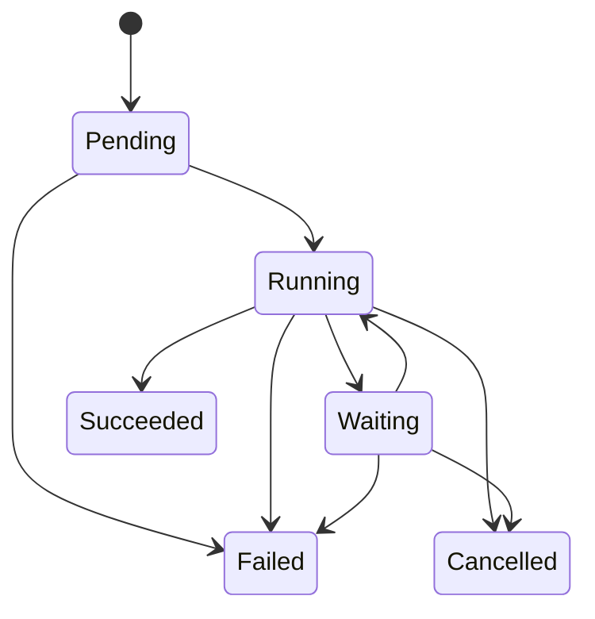

# P0 Golden Path — Rewrite Acceptance Contract

Status: **implementation gate**  
Target: `avaargsh/agent-control-panel`

## Outcome

A clean deployment can accept a versioned AgentBundle, create an AgentRelease and stable Agent/Session/Run identities, dispatch a Run through a durable workflow adapter into a Sandbox provider, recover after API/reconciler process restart, and attach auditable evidence to the result.

## Vertical slice

1. Submit AgentBundle (schema validation + immutable digest).
2. Create AgentRelease referencing exact bundle digest and rollout intent.
3. Resolve/validate AgentIdentity, tenant scope and authorization.
4. Create Session and Run with client idempotency key; duplicate submission returns the same canonical record.
5. Persist Run intent + outbox event in one transaction.
6. Reconciler dispatches through WorkflowProvider adapter with stable workflow/run identity.
7. Workflow adapter requests SandboxProvider allocation/claim using provider-neutral requirements and Run identity.
8. Runtime execution reports status/events; Control Plane updates Run state through validated transitions.
9. Evidence links exact bundle/release, Session/Run, workflow execution, Sandbox provider resource, operation ID and final observation.
10. Restart API and reconciler during each critical window; durable state resumes without duplicate logical Run or uncontrolled provider side effect.

## Required state machine

Transitions are conditional on persisted version and authorized actor/event. No terminal-state reopening in P0. Provider ambiguity is represented explicitly and reconciliation takes precedence over blind retry; `Unknown` may be a provider-operation status, not a Run terminal state.

## P0 acceptance tests

- Contract/schema tests for AgentBundle, AgentRelease, Session and Run.
- State-machine tests: allowed edges, forbidden edges, concurrent stale writes and terminal immutability.
- Persistence tests: transactional outbox, idempotent Run creation, durable identity.
- Crash tests: process restart before dispatch, after dispatch but before acknowledgement, and after provider side effect but before persistence.
- Provider contract tests: idempotency key, inspect/reconcile operation, cancellation, timeout/unknown handling.
- AuthZ tests: tenant boundary, Agent/Session/Run scope, CredentialBinding access, revoked identity.
- Secret hygiene tests: serialized API responses, logs, events and evidence do not expose secret bytes.
- Evidence tests: stable digest/reference, links to exact Release and Run, verifier rejects tampered content.
- Fresh-process recovery test: restart service and independently inspect persisted Run and evidence state.

## Out of scope for the first slice

- UI feature completeness.
- Multi-cluster federation implementation.
- GPU scheduler implementation.
- New Agent framework, custom workflow engine or custom Sandbox runtime.
- Broad legacy port without an ownership map and tests.
- Production deployment or migration of the legacy repository.

## Delivery order

1. Freeze domain and public API contracts; record unresolved design decisions.
2. Choose stack based on existing repo constraints and current source project, not preference alone.
3. Implement persistence + state machine + idempotency.
4. Implement reconciler/outbox and workflow adapter contract.
5. Implement SandboxProvider contract and OpenKruise Agents thin adapter.
6. Complete fault-injection/recovery and security acceptance tests.
7. Add UI operations after API contracts are verified.

## Exit gate

P0 is complete only when all required tests pass in a clean checkout and the restart/fault acceptance evidence is freshly generated. A happy-path demo alone is insufficient.

## 2026-11-18 Goal execution checkpoint

Architecture target: enterprise Agent platform with strict control/execution,
model/permission, state/process, execution/verification separation. ACP is
the only upper control plane. Runtime owns canonical Run/Attempt/Turn and
Temporal history; SandboxProvider owns execution substrate and command/WAL
lifecycle; EngageGuard owns protected-operation authorization, Permit,
execution receipt and UNKNOWN; independent Verifier owns check execution
and attestations. Do not substitute a competing authority or enable egress
to make a demonstration pass.

### Capability inventory (evidence levels, not a production claim)

| Class | Capability | Observed evidence / remaining gate |
|---|---|---|
| Implemented (non-production) | Immutable input, RunIntent and authenticated StartRun | ACP #55 integrated `9f26c9429651ab3c3e91336b3c0d0fb90412ec6c`; Go/PG16 #44247866936; actual two-process mTLS/ACK-loss #44247866931. No production ingress. |
| Implemented (non-production) | Tenant/project role + release/session ownership authorization | ACP #60 `6e705a478042df81082528bf4cdce5b664a1c6ed`, PG16 #44248380465, live catalog row locking and stale-grant denial. |
| Partial | OAuth/OIDC and Run identity | TLS introspection and exact OAuth client/scope + catalog exist; real issuer provisioning, end-user OIDC and rotating credentials not accepted. Runtime owns immutable snapshot and canonical IDs. |
| Partial | InspectRunIntent/UNKNOWN | Recovery and fencing tested; Runtime #37 `3b7b5579442a629a5b7a35962a5f2c0b2cfd4d42` full-binding PG17 #44248994491; ACP #61 consumer and cross-service conflict test under validation. No final absence barrier. |
| Partial | ACP + Temporal execution | Runtime #36 `7df4bcafbd84896068df927241cce13aa573d344` real Temporal #44248284146, Go/PG17 #44248284103. No-egress probe only; same accepted ACP Run -> actual business Workflow/Checkpoint still missing. |
| Partial | Sandbox, AgentD, Command Journal | agent-infra #20 sandbox reuse model, #21 real KVM isolation open. Do not replace Go Runtime identity with agent-infra migration target; no verified shared substrate or long-command journal. |
| Partial | EngageGuard and Scoped Permit | EngageGuard #10/#11 and Runtime #23: permit/intent/audit integrity primitives; no trusted integrated executor, live Run safety authority, revocation/delegation or signed receipt proof. |
| Partial | Independent Verifier and Evidence Journal | Runtime #27 repository-local verification contract; ACP #11 EvidenceRef governance; aga-verify-agent is a review skill, not an independent deployed attestation service. |
| To verify | Real Provider WORM/GC/restart, actual Sandbox isolation | ACP #53 legacy MinIO/PG16 #44238823007 PASS; approved provider, least privilege, retention and KVM A->B reuse remain unproven. |
| To implement | Independent Credential Broker and egress enforcement | Short-lived audience/operation-scoped credential lease, network enforcement and audit outside Sandbox; no production long-lived credential in Agent/Workspace/Temporal payload. |
| To implement | Business Golden Path, OpenTelemetry and independent verdict | GitHub Issue -> isolated Sandbox -> repair/test/recovery -> independent verifier -> Guard approval/PR -> digest-bound Evidence -> UID-fenced resource cleanup. Correlate trace/run/attempt/command/operation/evidence without secrets. |
| Blocked | Production release/merge | ACP #3/#10/#11, Runtime #20/#22/#23/#27, Guard #3. Service-owner contract ratification, independently reviewed exact-head changes, branch rules, real issuer/provider/staging, DB role separation and real protected execution/evidence required. |

The next acceptance gates are ordered: (1) real issuer and catalog
provisioning/least privilege, full-bound Start/Inspect; (2) same accepted
Run through actual Temporal workflow and crash-safe Checkpoint; (3)
isolated Sandbox AgentD and command journal; (4) Credential Broker and
egress audit; (5) Guard-scope Permit/approval/revocation and independent
operation recovery; (6) separately owned verifier and evidence/trace;
(7) real non-production GitHub repair PR and independently verified
resource cleanup. Each requires its own behavior RED, exact-head GREEN,
fault injection, source-pinned cross-service integration and independent
review. Missing credentials, cluster, KVM, role or protected provider
must be recorded as blockers, not replaced with a mock PASS.

All cited runs are from the corresponding historical commit, not proof
that subsequent integrated candidates or production environments passed.

## Same admitted Run to Temporal: actual non-production proof

[ACP #63](https://github.com/avaargsh/agent-control-panel/pull/63)
uses the live issuer fixture, actual ACP CatalogPolicy and PostgreSQL,
the real Runtime mTLS API and the existing Runtime Temporal dispatcher.
The external driver may only consume the one already accepted Run in
a clean disposable database; it must not seed a separate Run or grant.

Exact historical candidate `0cff5e1696f6211b5e498df19f96ce88274c7ae7`:
[CI #44250898589](https://github.com/avaargsh/agent-control-panel/actions/runs/44250898589)
executed `TestCrossServiceLostACKRecoversOneRuntimeRunAfterProcessRestart`
(PASS 15.65s, excluding provisioning/build) and
`TestExternalACPAdmissionTemporalRecovery` (PASS 11.72s).

- Live Keycloak image by immutable digest; actual service-account token,
  catalog roles and immutable input; unauthorized role replay denied.
- Two independent PostgreSQL databases; actual API process and verified
  TLS 1.3/SPIFFE acceptance, lost HTTP 201 ACK, SIGKILL/restart,
  full-bound v2 Inspect, stale-fence rejection and one canonical Run.
- Same Run's existing Runtime Outbox starts real Temporal; lost Temporal
  ACK, persisted server restart before worker execution, authoritative
  history verification and exactly one Start, Attempt and Turn.
- Wrong principal positive-control accepted under a distinct test intent,
  lost 409 ACK -> MANUAL_REVIEW, no duplicate logical Run.
- Runtime subprocesses use an explicit environment allowlist; issuer
  credentials are not forwarded. Test selectors require actual RUN/PASS.

Reproduce in a dedicated CI checkout using
`.github/workflows/acp-temporal-golden-path.yml`. It pins separate
issuer fixture `5b0109cbafcf659f2230f7a38fc560b8644332a9`, Runtime API
`157bad70f3ef35b7cbc8a674ad74b0eb8f2a1e55` (v10 accepted execution
binding immutability), and Runtime Temporal test driver
`def4d7c89ff60f17056a8b1ec4f72bc876d44ab9`. It provisions clean databases,
builds the two exact Runtime binaries, starts local HTTPS Keycloak and
runs the same ACP test with the external driver enabled. No live
production resources or credentials are required or permitted.

This is an **admission/identity/Temporal-start recovery milestone**, not
a successful business Run or independent verifier attestation. The
existing workflow is an isolated no-egress admission probe; the server
restarts before the worker processes the task. The actual Agent Loop,
durable business Checkpoint, Worker SIGKILL mid-business-step, authenticated
Decision Core contract (G02), model protection, Sandbox + AgentD,
credential broker, network egress gate and EngageGuard remain unproven.
Do not wire the development dispatcher to a shared production queue.
