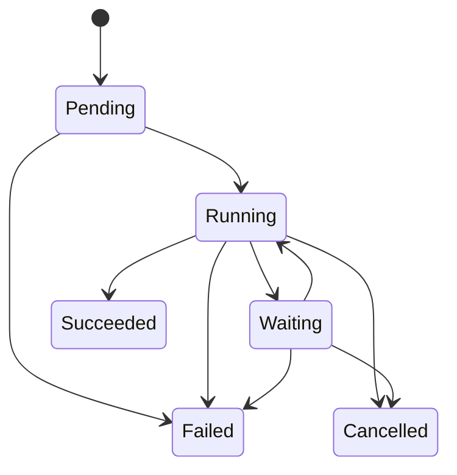

# P0 Golden Path — Rewrite Acceptance Contract

Status: **implementation gate**  
Target: `avaargsh/agent-control-panel`

## Outcome

A clean deployment can accept a versioned AgentBundle, create an AgentRelease and stable Agent/Session/Run identities, dispatch a Run through a durable workflow adapter into a Sandbox provider, recover after API/reconciler process restart, and attach auditable evidence to the result.

## Vertical slice

1. Submit AgentBundle (schema validation + immutable digest).
2. Create AgentRelease referencing exact bundle digest and rollout intent.
3. Resolve/validate AgentIdentity, tenant scope and authorization.
4. Create Session and Run with client idempotency key; duplicate submission returns the same canonical record.
5. Persist Run intent + outbox event in one transaction.
6. Reconciler dispatches through WorkflowProvider adapter with stable workflow/run identity.
7. Workflow adapter requests SandboxProvider allocation/claim using provider-neutral requirements and Run identity.
8. Runtime execution reports status/events; Control Plane updates Run state through validated transitions.
9. Evidence links exact bundle/release, Session/Run, workflow execution, Sandbox provider resource, operation ID and final observation.
10. Restart API and reconciler during each critical window; durable state resumes without duplicate logical Run or uncontrolled provider side effect.

## Required state machine

Transitions are conditional on persisted version and authorized actor/event. No terminal-state reopening in P0. Provider ambiguity is represented explicitly and reconciliation takes precedence over blind retry; `Unknown` may be a provider-operation status, not a Run terminal state.

## P0 acceptance tests

- Contract/schema tests for AgentBundle, AgentRelease, Session and Run.
- State-machine tests: allowed edges, forbidden edges, concurrent stale writes and terminal immutability.
- Persistence tests: transactional outbox, idempotent Run creation, durable identity.
- Crash tests: process restart before dispatch, after dispatch but before acknowledgement, and after provider side effect but before persistence.
- Provider contract tests: idempotency key, inspect/reconcile operation, cancellation, timeout/unknown handling.
- AuthZ tests: tenant boundary, Agent/Session/Run scope, CredentialBinding access, revoked identity.
- Secret hygiene tests: serialized API responses, logs, events and evidence do not expose secret bytes.
- Evidence tests: stable digest/reference, links to exact Release and Run, verifier rejects tampered content.
- Fresh-process recovery test: restart service and independently inspect persisted Run and evidence state.

## Out of scope for the first slice

- UI feature completeness.
- Multi-cluster federation implementation.
- GPU scheduler implementation.
- New Agent framework, custom workflow engine or custom Sandbox runtime.
- Broad legacy port without an ownership map and tests.
- Production deployment or migration of the legacy repository.

## Delivery order

1. Freeze domain and public API contracts; record unresolved design decisions.
2. Choose stack based on existing repo constraints and current source project, not preference alone.
3. Implement persistence + state machine + idempotency.
4. Implement reconciler/outbox and workflow adapter contract.
5. Implement SandboxProvider contract and OpenKruise Agents thin adapter.
6. Complete fault-injection/recovery and security acceptance tests.
7. Add UI operations after API contracts are verified.

## Exit gate

P0 is complete only when all required tests pass in a clean checkout and the restart/fault acceptance evidence is freshly generated. A happy-path demo alone is insufficient.
